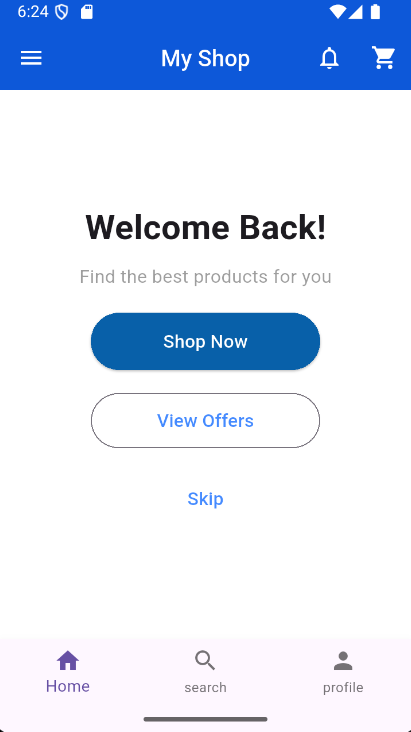
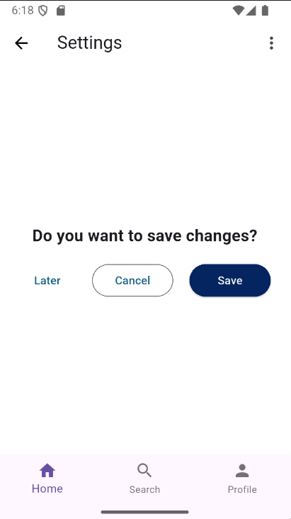
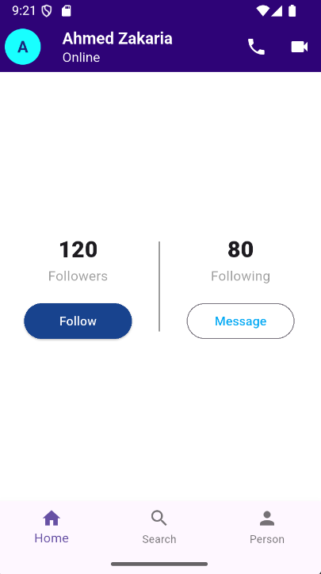

# 🛒 My Shop & Profile App (Flutter UI)

A sleek, responsive, and modern mobile application interface built with **Flutter**. This repository showcases clean UI design patterns, custom button components, and a structured layout for e-commerce and social profile flows.

---

## 📸 Screenshots

<p align="center">
  
  
  
</p>

---

## ✨ Features

- **Home Screen:**
  - Custom App Bar with quick actions (Cart and Notifications).
  - Welcome banner with multiple button hierarchy (*Shop Now*, *View Offers*, and *Skip*).

- **Settings Screen:**
  - Save changes dialog UI featuring clear user options (*Later*, *Cancel*, and *Save*).
  - Navigation bar with back action and overflow options.

- **Profile Screen:**
  - User header displaying online status and communication shortcuts (Call and Video buttons).
  - Social stats counters (Followers and Following).
  - Direct action buttons (*Follow* and *Message*).

- **Bottom Navigation:**
  - Persistent bottom navigation bar across main screens for seamless user navigation.

---

## 🛠 Tech Stack

- **Framework:** [Flutter](https://flutter.dev/)
- **Language:** [Dart](https://dart.dev/)
- **Design System:** Material Design

---

## 🚀 Getting Started

Follow these steps to run the project locally on your machine:

### Prerequisites
Make sure you have Flutter installed on your machine. If not, follow the official [Flutter Installation Guide](https://docs.flutter.dev/get-started/install).

### Installation

1. **Clone the repository:**
   ```bash
   git clone [https://github.com/your-username/your-repo-name.git](https://github.com/your-username/your-repo-name.git)
